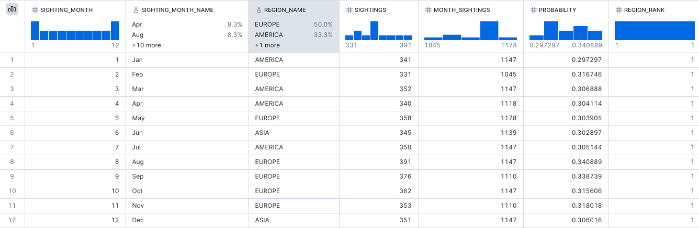
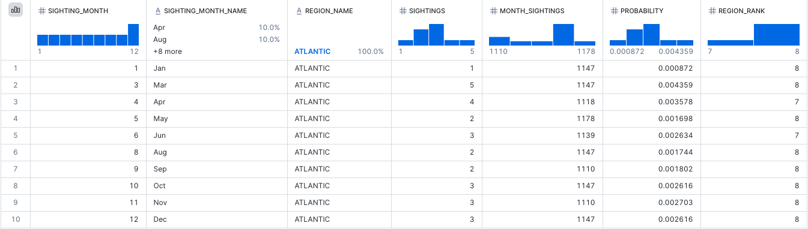
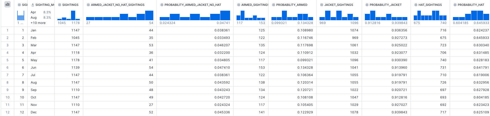
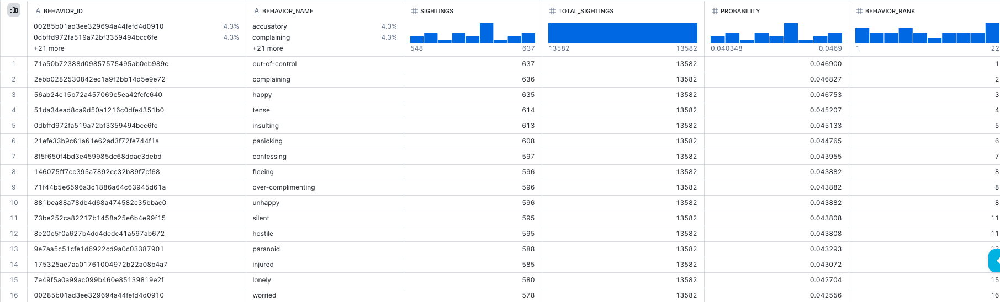
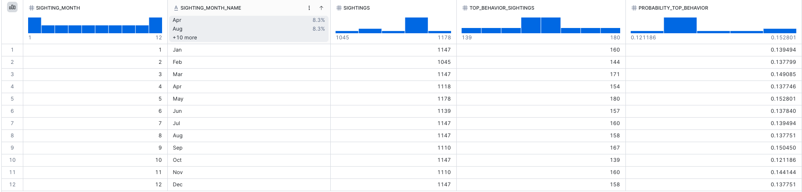
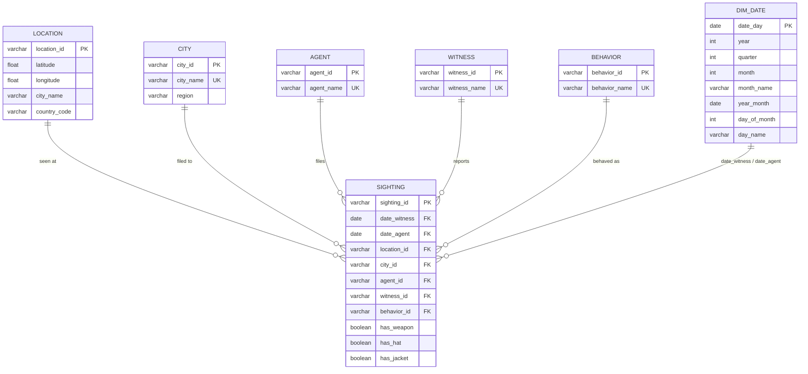

# Where in the World is Carmen Sandiego?

## Summary
| | |
|---|---|
| **Database** | **Snowflake** (database `CARMEN_ASSIGNMENT`), run through dbt Cloud |
| **dbt packages** | `dbt-labs/dbt_utils` (surrogate keys, date spine, composite-key tests) |
| **Input** | field reports across 8 regional sheets, 1985 – 2022 |
| **Layers** | raw seeds → 8 staging views → 1 union view → 7 normalised core tables → 4 analytics views |
| **Normal form** | Core schema is in **BCNF** (and therefore 3NF); every candidate key and foreign key is enforced by a dbt test |
| **Tests** | 172 data tests, all passing |

**Answers in one line each**

- **(a)** Carmen is most likely to be found in **EUROPE** (6 of 12 months), **AMERICA** (4 months) or **ASIA** (2 months), but the three regions are within one or two percentage points of each other most months. **EUROPE** has its highest share of sightings from Aug until Nov. **AMERICA** leads mostly early in the year - Jan, Mar and Apr and then again in Jul.



**ATLANTIC** has not sightings reported in Feb and Jul. This could be a potential data entry error



- **(b)** She is armed, wearing a jacket and *not* a hat in only **~4%** of sightings (2.4% – 4.7% by month). She almost always wears a jacket (91-94%), usually a hat (60-65%) and is rarely armed (11%), and these traits are independent of each other.



- **(c)** Her three most occurring behaviours are **out-of-control (637)**, **complaining (636)** and **happy (635)**, which are separated by one sighting each.


- **(d)** In any month, there is a **~14%** chance (12.1% – 15.3%) she shows one of those three behaviours, so she has no signature behaviour.



---

## Contents

1. [Understanding the problem](#1-understanding-the-problem)
2. [Architecture: layers and schemas](#2-architecture-layers-and-schemas)
3. [Step 1 — Extract: seeds](#3-step-1--extract-seeds)
4. [Step 2 — Map to the common data dictionary: staging views](#4-step-2--map-to-the-common-data-dictionary-staging-views)
5. [Step 3 — Beyond 1NF: the core schema](#5-step-3--beyond-1nf-the-core-schema)
6. [Step 4 — Analytics views and answers](#6-step-4--analytics-views-and-answers)
7. [Assumptions and data caveats](#7-assumptions-and-data-caveats)
8. [Testing](#8-testing)
9. [What I would do next](#9-what-i-would-do-next)

---

## 1. Understanding the problem

In the original game, the player is a detective chasing a thief across the world. In each city, witnesses give two kinds of clue: **where the thief went next** and **what the thief looks like**. The player collects these clues, works out the route, and identifies the suspect.

This dataset is that game's case file. Each row is one witness report, written up by a field agent and filed to a regional Interpol HQ:

| Data dictionary column | Meaning in the game |
|---|---|
| `date_witness`, `witness` | Who saw Carmen and when — **the sighting event** |
| `agent`, `date_agent`, `city_agent` | Who filed the report, when, and to which HQ |
| `city`, `country`, `latitude`, `longitude` | Where she was seen — the sighting location by the witness |
| `has_weapon`, `has_hat`, `has_jacket` | What she looked like — here appearance) |
| `behavior` | How she acted |
| *(sheet name)* | The agency region the HQ belongs to - comes from the individual region sheets |


---

## 2. Architecture: layers and schemas


| Layer | Snowflake schema | Materialisation | Purpose |
|---|---|---|---|---|
| Raw | `raw` | table (seed) | Exact copy of each sheet |
| Staging | `staging` | **view** | One view per source, mapped to the data dictionary|
| Intermediate | `intermediate` | view | Union of the 8 sources |
| Core | `core` | **table** | Normalised schema |
| Analytics | `analytics` | **view** | One view per question |


---

## 3. Step 1 — Extract: seeds

- Each sheet was exported to a CSV in `seeds/`, named `carmen_sightings_20220629061307_<REGION>.csv`. 
- `seeds/_seeds.yml` loads each CSV into the `raw` schema with **`quote_columns: true`**. This keeps every header exactly as it is in Excel, including `armed?`, `chapeau?` and `纬度`, which Snowflake can't store unquoted.
- **The raw layer is not modified in any way.** All renaming and type casting happens in staging, where it can be seen and reviewed.
- I considered reading the `.xlsx` directly, but Snowflake has no native Excel reader, and seeds are reproducible from the repo with no extra tooling. That is why I chose seeds, as the assignment's hint suggests.

---

## 4. Step 2 — Map to the common data dictionary: staging views

The ask was to create view models that columnarly maps eight different sources, each into this common data dictionary

### How it works

**1. The dictionary is declared once in `models/staging/_staging.yml`** (as a YAML anchor shared by all 8 views). Each column has its name, type, description, synonyms and tests:

```yaml
- name: date_agent
  data_type: date
  description: Date of field agent filing the report
  config:
    meta:
      synonyms: [date_agent, date_filed, 报道, reported, file_on]
  data_tests: [not_null]
```

**2. One macro, `stg_carmen(region)`, generates each view.** It reads the seed's actual columns from Snowflake and, for each dictionary column, finds the one source column that matches a synonym. It then generates `cast("<source column>" as <data_type>) as <dictionary name>`, and adds `region` from the sheet name. Each staging model is a single line:

```sql
-- stg_carmen_europe.sql
{{ stg_carmen('EUROPE') }}
```

It compiles to:

```sql
select
    cast("date_witness" as date)         as date_witness
    , cast("witness" as varchar)         as witness
    , cast("agent" as varchar)           as agent
    , cast("date_filed" as date)         as date_agent
    , cast("region_hq" as varchar)       as city_agent
    ...
    , cast("armed?" as boolean)          as has_weapon
    , cast("chapeau?" as boolean)        as has_hat
    , cast("coat?" as boolean)           as has_jacket
    , cast("observed_action" as varchar) as behavior
    , cast('EUROPE' as varchar)          as region
from <raw>.carmen_sightings_20220629061307_EUROPE
```

**3. The output is enforced by a model contract.** `contract: enforced: true` on the staging folder makes dbt check, at build time, that every view has exactly the dictionary's column names and data types.

**4. Mistakes stop the build.** If a dictionary column matches no source column, or more than one, compilation stops with an error naming the region, the column and the candidates. A new or changed sheet can never produce a silently wrong view.

```jinja
{{ exceptions.raise_compiler_error(
    region ~ ': "' ~ column.name ~ '" should match exactly one seed column from '
    ~ synonyms ~ ', but matched ' ~ matches
) }}
```

### Column mapping (as declared by the synonyms)

The table lists every column name in each regional seed file and the data dictionary column it maps to.

| Dictionary column | EUROPE | ASIA | AUSTRALIA | PACIFIC | AFRICA · AMERICA · ATLANTIC · INDIAN |
|---|---|---|---|---|---|
| `date_witness` | date_witness | sighting | witnessed | sight_on | date_witness |
| `witness` | witness | citizen | observer | sighter | witness |
| `agent` | agent | officer | field_chap | filer | agent |
| `date_agent` | date_filed | 报道 | reported | file_on | date_agent |
| `city_agent` | region_hq | city_interpol | interpol_spot | report_office | region_hq |
| `country` | country | nation | nation | nation | country |
| `city` | city | city | place | town | city |
| `latitude` | lat_ | 纬度 | lat | lat | latitude |
| `longitude` | long_ | 经度 | long | long | longitude |
| `has_weapon` | armed? | has_weapon | has_weapon | has_weapon | has_weapon |
| `has_hat` | chapeau? | has_hat | has_hat | has_hat | has_hat |
| `has_jacket` | coat? | has_jacket | has_jacket | has_jacket | has_jacket |
| `behavior` | observed_action | behavior | state_of_mind | behavior | behavior |
| `region` *(added)* | `'EUROPE'` | `'ASIA'` | `'AUSTRALIA'` | `'PACIFIC'` | sheet name |

### Design decisions

- **One definition.** Names, types, descriptions, synonyms, tests and the contract all come from one YAML block. Adding a ninth region means adding any new synonyms and a one-line model.
- **Matched by name, not by position.**Columns are matched by synonym, with a guardrail that checks each dictionary column matches exactly one seed column. The matching is not done based on column position. The build stops if it finds more than one match or no match at all.
- **Synonyms** The usual alternative is a mapping seed with one row per column, per region with a common alias (eg: `sighting as date_witness`) which is repetitive code. Additionally, a new region would also mean adding the same repetitive code. The synonym list records each regional name **once**, against the dictionary column it means, so the whole mapping fits in 13 short lists. A new region whose names are already known needs no change at all. This is my interpretation of the assignment's -  **"call each 'yablaka' an apple"** part.
- **`region` is added from the sheet name**, because it is not a column in any source. Without it, step 3 could not record which region each HQ belongs to.

### intermediate layer for combining all the sheets (`int_sightings_unioned`)

The 8 views are combined with `union all` into one view. It sits in its own layer so that combining the sources and normalising them stay separate steps. It is also the single input to every core model, and the place where tests on the combined data run:
- `(date_witness, witness, agent, city, country)` is unique, which makes it a natural key for a report
- `region` is one of the 8 accepted values
- `date_agent >= date_witness` (warn only; no rows break it)

---

## 5. Step 3 — Beyond 1NF: core schema

### 5.1 Entity-relationship diagram



### 5.2 The tables

| Table | Grain | Rows | Keys | Notes |
|---|---|---:|---|---|
| `sighting` | one field report | 13,582 | PK `sighting_id`; UK `(date_witness, witness_id, agent_id, location_id)` | The sighting event. Holds only foreign keys, the two dates for date of sighting and the date when the agent filed the report along with the three flags |
| `location` | one place where Carmen was seen | 958 | PK `location_id`; UK `(latitude, longitude)`; UK `(city_name, country_code)` | Coordinates, city and country of the sighting. No region |
| `city` | one HQ city agents file to | 181 | PK `city_id`; UK `city_name` | The **only** place region is stored |
| `agent` | one field agent | 510 | PK `agent_id`; UK `agent_name` | |
| `witness` | one witness | 12,525 | PK `witness_id`; UK `witness_name` | |
| `behavior` | one observed behaviour | 23 | PK `behavior_id`; UK `behavior_name` | |
| `dim_date` | one calendar day | 13,633 | PK `date_day` | 1985-04-23 to 2022-08-19; used for both `date_witness` and `date_agent` |

Every column in the data dictionary is stored exactly once:

| Dictionary column | Stored in |
|---|---|
| `date_witness`, `date_agent` | `sighting` (→ `dim_date`) |
| `witness` / `agent` / `behavior` | `witness.witness_name` / `agent.agent_name` / `behavior.behavior_name` |
| `city_agent` | `city.city_name` (via `sighting.city_id`) |
| `city`, `country`, `latitude`, `longitude` | `location` (via `sighting.location_id`) |
| `has_weapon`, `has_hat`, `has_jacket` | `sighting` |
| *(region)* | `city.region` |

### 5.4 Why this meets "beyond 1NF"

- **2NF:** every table has a single-column key, so no attribute can depend on only part of a key.
- **3NF:** there are no transitive dependencies. `sighting` stores only `location_id`, not the city, country or coordinates. It stores only `city_id`, not the region. Region is stored once per HQ, not once per report.
- **BCNF:** every determinant is a candidate key. In `location`, the determinants are `location_id`, `(latitude, longitude)` and `(city_name, country_code)`, and all three are unique. In `city`, `city_name` determines `region` and is unique.
- **4NF / 5NF:** each report has exactly one behaviour, location and HQ, and the flags are single-valued, so there are no multi-valued or join dependencies to remove.
- **Not 6NF, deliberately:** one table per attribute (e.g. a table per flag) would only add joins without improving correctness.

### 5.5 Design decisions and alternatives considered

| Decision | Alternative considered | Why I chose this |
|---|---|---|
| Separate `city` (HQ) and `location` (sighting place) | One shared `city` table for both roles | They are different things. An HQ is a regional office that collects reports from many surrounding cities (New York covers 70), and in 99% of reports the sighting city is not the HQ city. The data also describes them differently: an HQ has a region but no country or coordinates, and a sighting place has a country and coordinates but no region. One table would need nullable columns, and a key on the city name would merge different places that share a name. Sydney, Australia is an HQ, but "Sydney" as a sighting city is Sydney, Nova Scotia, Canada, which reports to Glace Bay. Madrid (Colombia) and Dublin (US) have the same problem |
| Region only on the HQ `city` | Region on `location` or `country` | Region is assigned by the HQ a report is filed to. This assumption was based on the assignment's text - **there is an Interpol agency HQ in a city of each region to which the agents report** |
| `country_code` on `location`, no `country` table | A `country` table | The source has only the code. A table with just a key and the code adds a join and removes no redundancy |
| `region` as text on `city`, no `region` table | A `region` table with `region_id` | Same reasoning: region has no other attributes. An `accepted_values` test restricts it to the 8 regions |
| Flags (`has_weapon`, `has_hat`, `has_jacket`) on `sighting` | An `attire` lookup (4 hat/jacket combinations), a `weapon` lookup (2 rows), or a `trait` many-to-many table | Each flag describes that one sighting, so it depends on the whole key. A lookup table would replace a boolean with a foreign key carrying the same information |
| Not building a combined location + HQ + region dimension | A Kimball-style flattened `dim_location` | It would bring back the HQ → region transitive dependency and mix two distinct entities. None of the questions needs it |

**The normalised core is also a star schema.** `sighting` is a transaction fact table at the atomic grain (one row per report). `location`, `city`, `agent`, `witness`, `behavior` and `dim_date` are its dimensions, and the flags are on the fact. The dimensions are small and have no internal hierarchy, so the 3NF design and the dimensional design end up identical. That is why the analytics views need at most two joins.

### 5.6 How the keys are built

- **Surrogate keys** are deterministic hashes of each entity's natural key (`dbt_utils.generate_surrogate_key`). Rebuilding the project always produces the same IDs, and no sequences are needed.
- **Each key is defined once, in its dimension.** `sighting` doesn't recompute the hashes. It looks the keys up by joining to each dimension (on coordinates for `location`, on names for the rest), so the dbt lineage graph shows exactly the relationships in the ERD.
- **The joins are left joins.** If a report has no matching dimension row, it is kept with a null key instead of being silently dropped. The `not_null` tests on every foreign key, and an `equal_rowcount` test against the union, make any such gap fail the build. In the current data every report matches.

---

## 6. Step 4 — Analytics views and answers

### Conventions

- **"Month" means the calendar month (1–12) of `date_witness`**, the date Carmen was actually seen, pooled across all 38 years. This answers "where is she likely to be in a given month" directly, and gives each month more than 1,000 sightings, so the probabilities are stable. `dim_date.year_month` supports a year-by-year breakdown if one is needed.
- **Probabilities are stored as unrounded fractions (0–1), next to the counts they are calculated from**, so they can be combined or re-aggregated correctly. The views contain no percentages: a view returns `0.297297`, and displaying it as 29.7% is left to the reporting or visualisation tool. 
- **Ranks use `rank()`**, so ties share a rank and are shown, not silently dropped.
- **The views are not filtered to the answer.** They return the full distribution (every region, every behaviour) with a rank column.

### (a) For each month, which agency region is Carmen most likely to be found in?

**View:** `monthly_region_likelihood`, joining `sighting → dim_date` (month) and `sighting → city` (region of the HQ the report was filed to).
**Logic:** count sightings per month and region, divide by that month's total (from a `monthly_totals` CTE), and rank the regions within each month.

**Observations**
- EUROPE, AMERICA and ASIA together account for 87% – 90% of sightings in every month. The other five regions are never most likely: AFRICA 8.8% overall, and AUSTRALIA, INDIAN, PACIFIC and ATLANTIC under 1.3% each.
- Within the top three the margins are often only a few sightings (January: 341 vs 339). The clearest pattern is **EUROPE from August to November**.
- These are probabilities of being **reported** in a region. Regions with more agents and more population will produce more reports wherever she actually is, so the result reflects reporting volume as much as her movements.

### (b) For each month, what is the probability she is armed AND wearing a jacket, but NOT a hat?

**View:** `monthly_armed_jacket_no_hat`, reading `sighting` and joining `dim_date`.
**Logic:** `count_if(has_weapon and has_jacket and not has_hat) / count(*)` per month. The view also gives the single-trait counts and probabilities, which support the observations below.

**Observations**
- **She almost always wears a jacket (91-94%) and usually a hat (60-65%).** The probability of her other looks - jacket only (34.5%), hat only (4.8%) and neither (2.7%).
- **She is rarely armed (11.4%)**.
- **The traits are independent.** P(armed) × P(jacket) × P(no hat) = 0.114 × 0.925 × 0.372 ≈ **3.93%**, almost exactly the observed 3.92%. Being armed doesn't change what she wears: P(hat | armed) = 62.3% vs P(hat | unarmed) = 62.8%. So the combination in this question is rare mainly because being armed is rare.
- **Seasonality is weak.** Jacket wearing barely changes with the seasons, which is surprising for clothing.

### (c) What are the three most occurring behaviours?

**View:** `top_behaviors`, joining `sighting → behavior`.
**Logic:** count sightings per behaviour, divide by the total (from a `totals` CTE), and rank all 23 behaviours. The top three are `behavior_rank <= 3`.

**Observations:** the 23 behaviours are almost evenly spread, from 548 to 637 sightings each (4.0% – 4.7%). The top three are separated by **one sighting each**, so the ranking is very fragile.

### (d) For each month, what is the probability she exhibits one of her three most occurring behaviours?

**View:** `monthly_top_behavior_probability`, joining `sighting → dim_date` and left-joining `top_behaviors` filtered to `behavior_rank <= 3`.
**Logic:** sightings that month with a top-3 behaviour ÷ all sightings that month. The top three are defined once, in `top_behaviors`, and reused here.

**Observations:** if all 23 behaviours were equally likely, any three of them would account for 3 / 23 = **13.0%** of sightings. Her top three reach 14.0%, so they are only slightly more common than chance, and the figure barely moves across the year. In practice her behaviour is unpredictable: witnesses can't expect a particular demeanour, unlike her clothing.

---

## 7. Assumptions and data caveats

1. **A name identifies one person.** The source has no witness or agent IDs. Two "Laura Brown"s in different cities may be different people, but they share one `witness` row.
2. **Region is the region of the HQ the report was filed to**, as the assignment describes. It is not derived from the sighting's country, because some countries are covered by more than one region.
3. **Month is the calendar month of the sighting date (`date_witness`)**, pooled across 1985 – 2022, not the filing date.
4. **Probabilities describe reports, not ground truth.** Reporting coverage varies by region (see (a)).

---

## 8. Testing

The tests are designed to prove the claims in this document, not just to check for nulls:

| What is tested | How |
|---|---|
| Every staging view matches the data dictionary | model contract (names and types) and `not_null` on all 14 columns of all 8 views |
| The union is a valid 1NF relation | composite natural key unique; `region` in the 8 accepted values; `date_agent >= date_witness` (warn) |
| **BCNF candidate keys** | `unique` on every PK and natural key; `unique_combination_of_columns` on `location(latitude, longitude)`, `location(city_name, country_code)` and `sighting(date_witness, witness_id, agent_id, location_id)` |
| **Referential integrity** | `relationships` from every `sighting` foreign key (including both dates) to its dimension |
| No report is lost | `equal_rowcount` between `sighting` and `int_sightings_unioned` |
| Analytics outputs are well-formed | one row per month in (b) and (d); one row per (month, region) in (a); unique behaviours in (c) |


---

## 9. What I would do next

- **Year-by-year view:** add views grouped by `dim_date.year_month` to show whether her regional pattern has changed over time.
- **Incremental loading:** if field reports arrived continuously, `sighting` would become an incremental model keyed on `sighting_id`.
